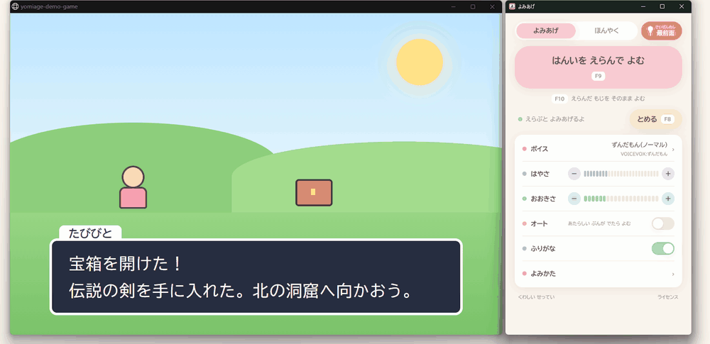
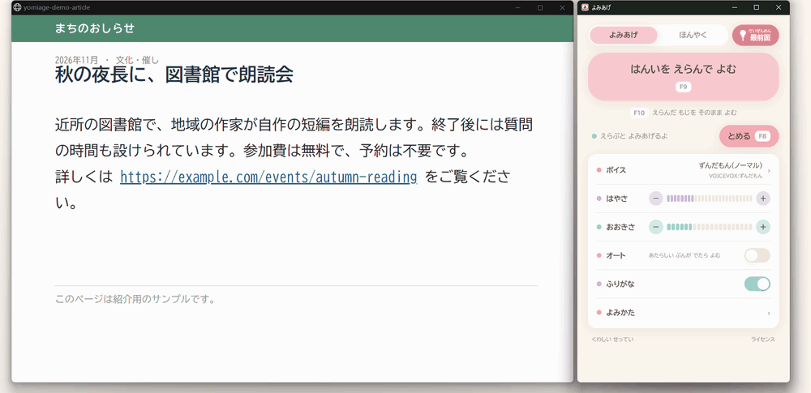
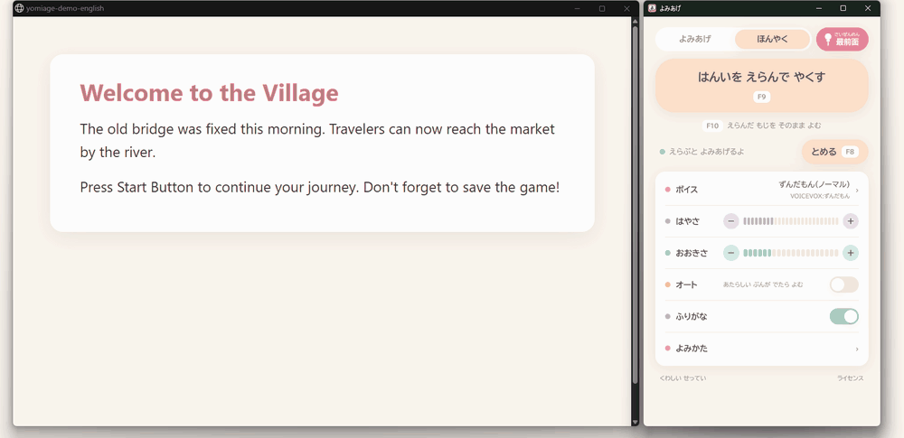
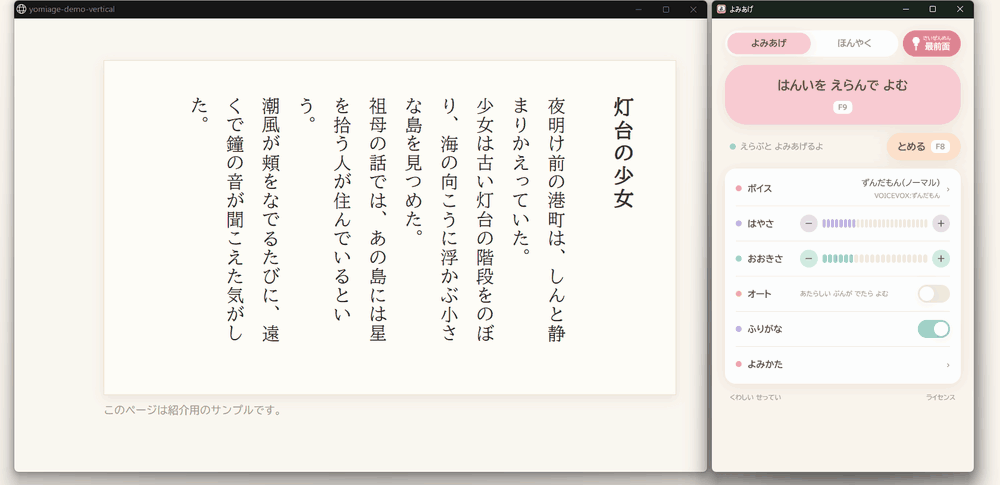

# yomiage - よみあげ

友人のために作った画面の文字を読み取り、VOICEVOX の声で読み上げる Windows 用のフリーのアプリです。

[リリース](https://github.com/tarou-imokenpi/yomiage-releases/releases/latest) から `yomiage-setup-<版>.exe` をダウンロードして実行してください。

### ゲームの文字を読み上げ

範囲を選ぶと、文字を読み取ってボイスで読み上げます。漢字にふりがなを付け、いま読んでいるところに色を付けます。

### Web の記事も読み上げ

長い文も、文ごとに区切って順に読み上げます。リンクは長いアドレスを読まず、「リンク」と短く読みます。

### 英語は翻訳して重ねて表示

「ほんやく」にすると、英語を日本語に翻訳して元の場所に重ねて表示し、読み上げます。

### 縦書きも読み上げ

縦書きの文章も、右の列から順に読み上げます。ふりがなは漢字の右に付けます。

動きに映っている画面は、紹介のために作ったサンプルです。読み上げの声: VOICEVOX:ずんだもん

## とくちょう

- 範囲を選ぶだけで、画面の文字をボイスで読み上げます。漢字にはふりがなを付け、読んでいる場所も表示します。
- 縦書きの文章も、右の列から順に読み上げます。
- 英語は翻訳して、元の場所に重ねて表示・読み上げします。英単語はカタカナの読みで読みます。
- 軽い: 読み終えて表示しているあいだの CPU 使用率は 0.02〜0.4%（16 コア合計の実測）。
- GPU があれば速い: 文字の読み取りは約 0.07 秒（GPU なしでは 0.6〜0.8 秒）。
- インストールするだけで使えます。はじめのダウンロードのあとは、インターネットなしで動きます。

## ライセンス

yomiage は [CC BY-NC-SA 4.0](LICENSE)（表示・非営利・継承）で公開しています。**営利目的では使えません。**

### アプリに同梱しているもの

| もの | 使いみち | ライセンス |
|---|---|---|
| [YomiToku](https://github.com/kotaro-kinoshita/yomitoku) の文字検出・文字認識モデル（作者: Kotaro Kinoshita） | 文字の読み取り（OCR） | [CC BY-NC-SA 4.0](https://creativecommons.org/licenses/by-nc-sa/4.0/legalcode.ja)（非営利のみ） |
| [ONNX Runtime](https://github.com/microsoft/onnxruntime) | OCR の推論 | MIT License |
| [DirectML](https://www.nuget.org/packages/Microsoft.AI.DirectML) | GPU で OCR を動かす | Microsoft のライセンス |
| [lindera](https://github.com/lindera/lindera) と IPADIC | ふりがなの読み | MIT License / IPADIC のライセンス |
| [JMdict](https://www.edrdg.org/wiki/index.php/JMdict-EDICT_Dictionary_Project)（EDRDG）から作った表 | 英単語のカタカナ読み | [CC BY-SA 4.0](https://creativecommons.org/licenses/by-sa/4.0/legalcode.ja) |
| [kanalizer](https://github.com/VOICEVOX/kanalizer)（VOICEVOX） | 表に無い英単語の読みの推測 | MIT License |
| [DotGothic16](https://fonts.google.com/specimen/DotGothic16) | ドット文字の訳文の書体 | SIL Open Font License 1.1 |
| [Mochiy Pop One](https://fonts.google.com/specimen/Mochiy+Pop+One) | アイコンの文字 | SIL Open Font License 1.1 |
| gpui ほか Rust のライブラリ | アプリ本体 | MIT / Apache-2.0 など |

### はじめて使うときに、利用規約に同意してダウンロードするもの

| もの | 使いみち | ライセンス |
|---|---|---|
| [VOICEVOX CORE](https://github.com/VOICEVOX/voicevox_core) | 読み上げ | MIT License |
| [VOICEVOX 音声モデル](https://github.com/VOICEVOX/voicevox_vvm) | 読み上げの声 | VOICEVOX 音声モデル 利用規約と、各キャラクターの利用規約 |
| [VOICEVOX 版 ONNX Runtime](https://github.com/VOICEVOX/onnxruntime-builder) | 読み上げ | VOICEVOX ONNX Runtime 利用規約 |
| [Open JTalk 辞書](https://github.com/r9y9/open_jtalk) | 読み上げ | Modified BSD License |
| [llama.cpp](https://github.com/ggml-org/llama.cpp) | ほんやく | MIT License |
| [PLaMo 3 Translate](https://huggingface.co/pfnet/plamo-3-translate-0.8b)（株式会社 Preferred Networks） | ほんやく | PLaMo Community License（Built with PLaMo） |

### 読み上げた音声を公開するとき

動画や配信などで使うときは、「VOICEVOX:ずんだもん」のように **「VOICEVOX:キャラ名」のクレジット表記** が必要です。キャラクターごとの利用規約も確認してください（[VOICEVOX](https://voicevox.hiroshiba.jp/)）。

各ライセンスの全文は、インストールしたフォルダの `licenses` と、アプリの「ライセンス」にあります。
